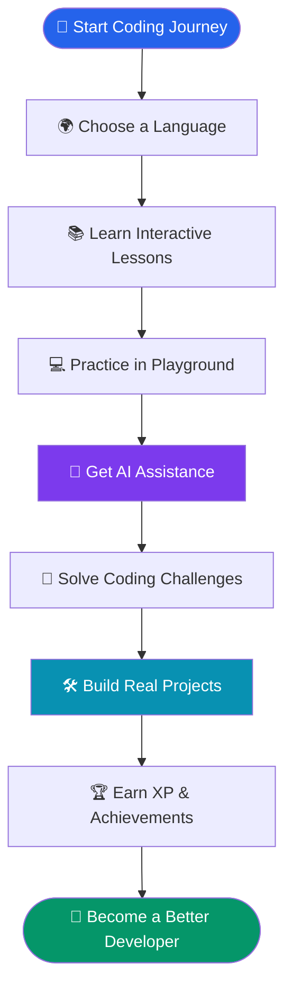

# ⚡ QODEX AI

  

  

  

  
  
  
  

---

## 🌟 Welcome to Qodex AI

**Qodex AI** is an interactive, beginner-friendly coding education platform designed to make programming easier, smarter, and more enjoyable.

Whether you're writing your first line of Python or building your next project, Qodex AI brings learning, coding practice, AI assistance, challenges, and project building together in one place.

> 💡 Don't just learn how to code. Experience the journey of becoming a developer.

## 🖥️ Platform Preview

  <b>🏠 Explore the Qodex AI Experience</b>

  

  <b>📚 Interactive Learning Experience</b>

  

---

## ✨ Why Qodex AI?

<table>
<tr>
<td width="50%" align="center">

### 🤖 AI Coding Tutor

Get assistance, understand complex concepts, and improve your coding skills with AI-powered guidance.

</td>
<td width="50%" align="center">

### 💻 Code Playground

Write, edit, execute, and experiment with code in an interactive environment.

</td>
</tr>
<tr>
<td width="50%" align="center">

### 📚 Smart Learning Paths

Follow structured lessons and learn programming step by step.

</td>
<td width="50%" align="center">

### 🧠 Coding Challenges

Test your knowledge and improve logical thinking with coding problems.

</td>
</tr>
<tr>
<td width="50%" align="center">

### 🛠️ Real-World Projects

Apply your programming knowledge through guided practical projects.

</td>
<td width="50%" align="center">

### 🏆 Gamified Learning

Earn XP, maintain streaks, unlock achievements, and track progress.

</td>
</tr>
</table>

---

## 📊 Qodex AI By The Numbers

  
  

  
  

---

## 🌍 Supported Programming Languages

  

| Language | Learning Focus |
|---|---|
| 🐍 Python | Programming fundamentals and logic |
| ⚙️ C++ | Problem-solving and performance |
| ☕ Java | Object-oriented programming |
| 🌐 JavaScript | Web development and interactivity |
| 🎨 HTML & CSS | Website structure and design |

---

## 🎮 Learning Made Interactive

  

- ⭐ Earn XP as you learn.
- 🔥 Maintain daily learning streaks.
- 🏅 Unlock achievements and badges.
- 📈 Track your learning progress.
- 🎯 Complete learning goals.
- 🚀 Improve through continuous practice.

## 🔄 Your Journey With Qodex AI

---

## 📸 More From The Platform

  <b>📊 Your Coding Journey, All in One Place</b>

  

---

## 🎯 Our Mission

We believe that programming education should be accessible to everyone.

Our mission is to remove the fear of coding by making learning interactive, practical, and beginner-friendly.

We want every learner to have the confidence to explore technology, solve problems, and turn ideas into real-world applications.

  <h3 align="center">LEARN. PRACTICE. BUILD. REPEAT.</h3>
  <h3 align="center">⚡ Code Your Future With Qodex AI.</h3>

---

## 💾 Project Information

| Information | Details |
|---|---|
| Project Name | Qodex AI |
| Category | AI-Powered EdTech |
| Platform | Web Application |
| Deployment | Base44 |
| Learning Paths | 5 |
| Guided Lessons | 55 |
| Coding Challenges | 11 |
| Guided Projects | 6 |
| Target Audience | Beginners & Students |

### 📌 Progress & Data

The current demo stores learning progress in the user's browser rather than a centralized server. Some learner stories and achievement examples are illustrative demo content.

---

## 🚀 Try Qodex AI Today!

  

  🌐 <b>Live Website:</b> https://qodexai-version2.base44.app

---

## 👨‍💻 Created By

  

  Built with a vision to make programming education smarter, easier, and accessible to everyone.

---

  

  <b>⚡ QODEX AI © 2026</b>
   
  <i>Built for learners. Designed for creators. Powered by curiosity.</i>
    
  ⭐ If you like this project, consider giving it a star!

